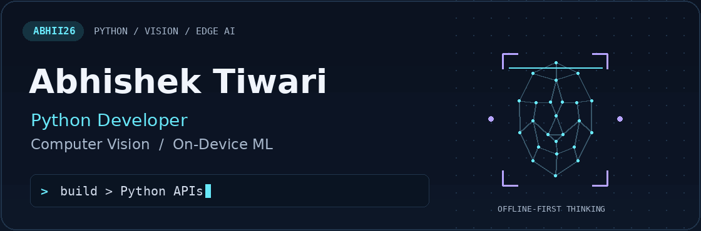
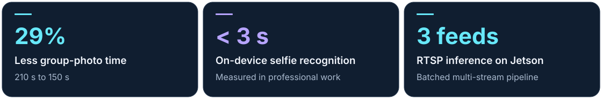
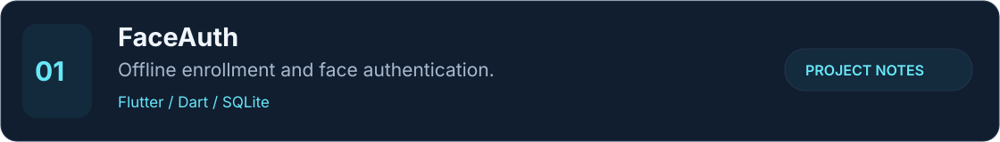
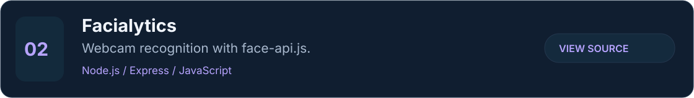

<picture>
  <source media="(max-width: 600px) and (prefers-reduced-motion: reduce)" srcset="assets/hero-mobile-static.png">
  <source media="(prefers-reduced-motion: reduce)" srcset="assets/hero-static.png">
  <source media="(max-width: 600px)" srcset="assets/hero-mobile.gif">
  
</picture>

  
  

I build **Python backends, computer vision systems, and ML applications that run on device**. My work connects recognition pipelines, mobile apps, and the APIs behind them.

I'm an **Associate Python Developer at Techkshetra Info Solutions**, based in Bengaluru, India. Interested in Python backend, computer vision, and edge AI opportunities.

## Engineering in practice

<picture>
  <source media="(max-width: 600px)" srcset="assets/impact-mobile.svg">
  
</picture>

These measurements come from my professional work and its test conditions. [Read the engineering context](projects/engineering-notes.md).

## Selected projects

<a href="projects/faceauth.md"><picture><source media="(max-width: 600px)" srcset="assets/faceauth-mobile.svg"></picture></a>

Offline embeddings, passive anti-spoofing, multi-frame liveness checks, and best-frame selection. **[Project notes](projects/faceauth.md)** · Public source link to be added when available.

<a href="https://github.com/Abhii26/Face_Recognition"><picture><source media="(max-width: 600px)" srcset="assets/facialytics-mobile.svg"></picture></a>

Face matching, expression detection, age and gender estimation, with local HTTPS for webcam access. **[Source](https://github.com/Abhii26/Face_Recognition)**

<a href="https://github.com/Abhii26/Shortifly"><picture><source media="(max-width: 600px)" srcset="assets/shortifly-mobile.svg"></picture></a>

Short links, click counts, and timestamped visit records. **[Source](https://github.com/Abhii26/Shortifly)**

## Tools I work with

**Core:** Python · Dart · JavaScript · SQL  
**Vision:** OpenCV · InsightFace · ArcFace · SCRFD · YOLOv8 · FAISS · DeepSORT  
**Inference:** ONNX Runtime · TensorRT · GStreamer · SAHI · Batched inference  
**Apps & APIs:** FastAPI · Flutter · Flask · Node.js · Express · REST · Socket.io  
**Data & tools:** SQLite · MySQL · PostgreSQL · MongoDB · Git · Linux · Postman

<strong>A little more about my background</strong>

- Associate Python Developer, Techkshetra Info Solutions — June 2026–present.
- Python Developer Intern, Techkshetra Info Solutions — March–May 2026.
- Backend Developer Intern, E-Definers Technology — January–April 2025.
- B.Tech in Information Technology, GGSIPU — graduated July 2025; CGPA 8.91/10.
- Built REST APIs, offline attendance workflows, and detection/re-identification pipelines on Jetson Orin.

## Let's connect

For Python backend, computer vision, or on-device ML conversations: **[LinkedIn](https://www.linkedin.com/in/abhishektiwari6/)** · **[Email](mailto:abhishektiwari7065@gmail.com)**.
